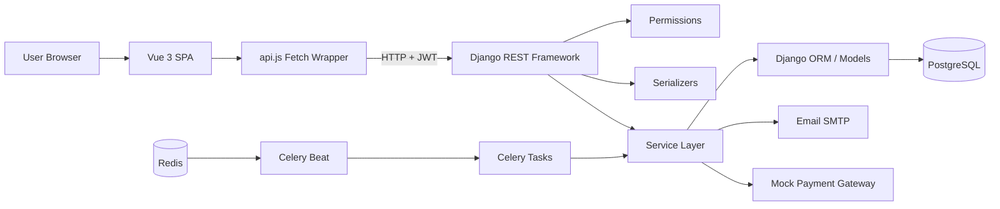
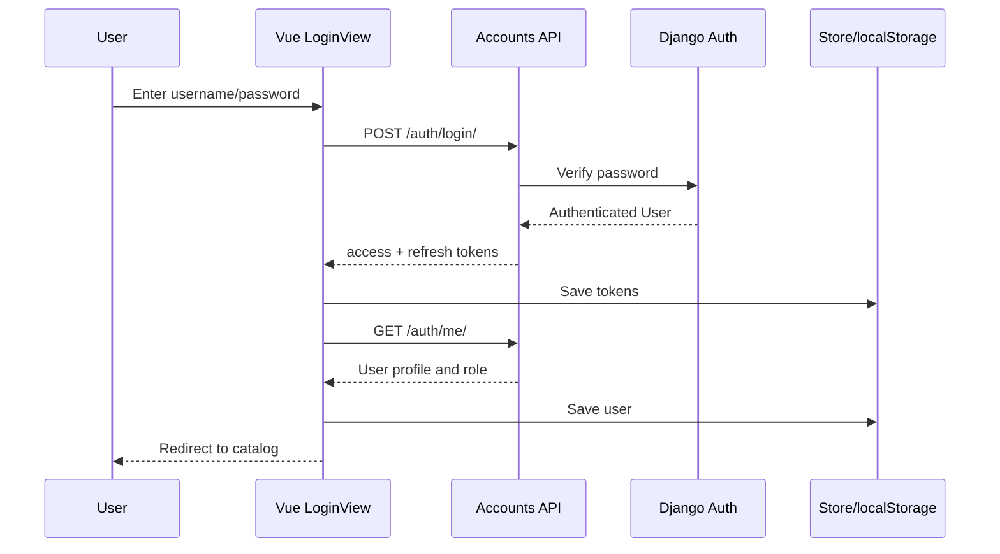
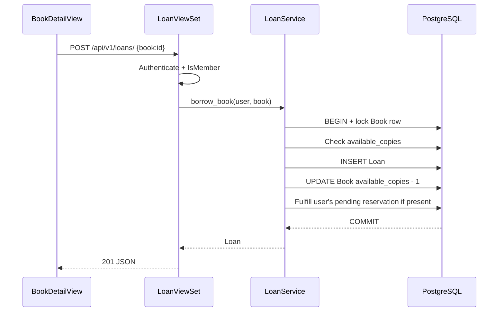
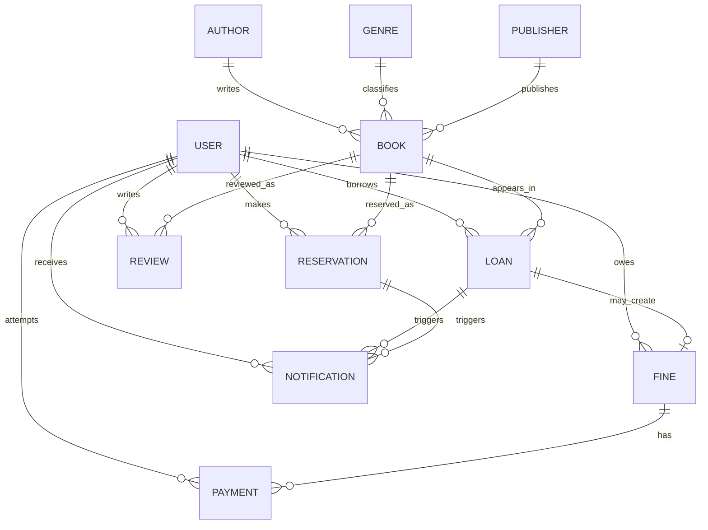
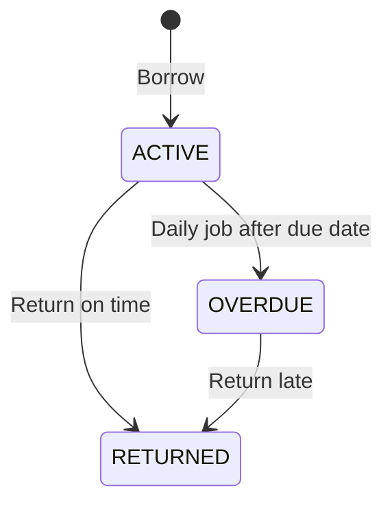
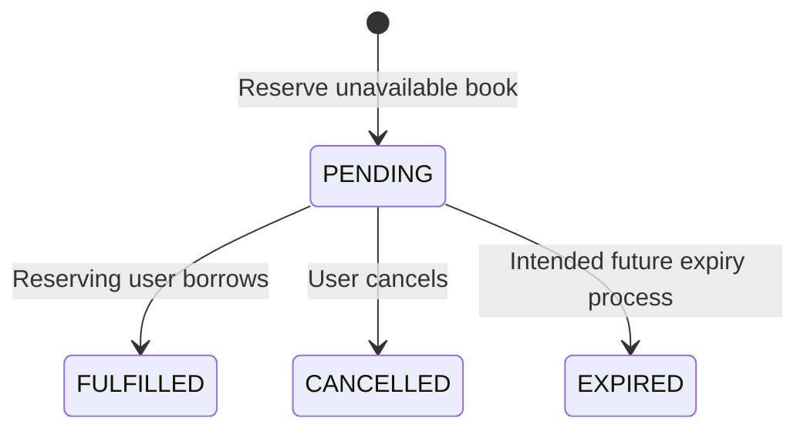
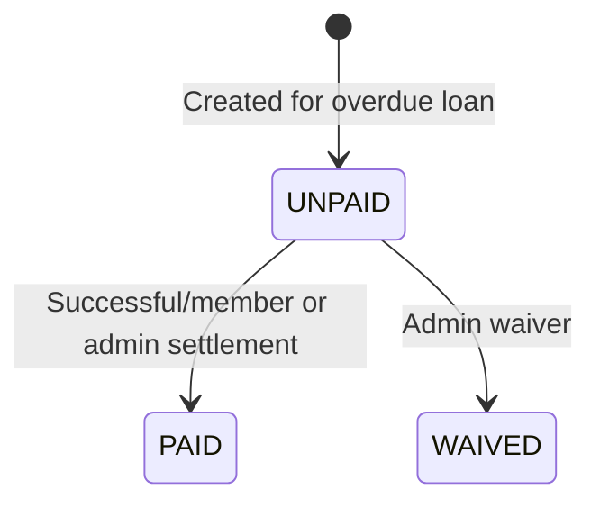

# Online Library Management System — Beginner-to-Presentation Cheat Sheet

> This guide explains the actual uploaded project, not just a generic Django/Vue application.
> Read **Sections 1–8** first for tomorrow's presentation. Use the rest when someone asks technical questions.

---

## 1. The whole system in one sentence

This is a **full-stack web application** where Vue displays the pages in the browser, Django REST Framework exposes APIs and enforces rules, PostgreSQL stores permanent data, and optional Celery/Redis jobs calculate fines and send reminders automatically.

### A 30-second explanation you can say

> “The system has a Vue 3 single-page frontend and a Django REST Framework backend. The frontend sends HTTP requests to versioned REST endpoints. Django authenticates the user with JWT, checks their role, validates input with serializers, runs business rules in service classes, and reads or writes PostgreSQL through Django models. The application covers catalog management, loans, returns, reservations, overdue fines, payments, notifications, reviews, member administration, and reporting.”

---

## 2. First understand these six words

Think of a restaurant:

| Technical term | Restaurant analogy | What it means here |
|---|---|---|
| **Frontend** | Dining room/menu | What the user sees and clicks in the browser |
| **URL/route** | Address/order number | Decides which code handles a request |
| **View** | Waiter/receptionist | Receives the request and returns the response |
| **Serializer** | Translator and form checker | Converts JSON ↔ Python/model data and validates fields |
| **Service** | Manager who applies business rules | Performs borrowing, returning, fine calculation, notification, etc. |
| **Model** | Official record book | Describes database tables and relationships |

The most important flow is:

```text
User clicks a button
       ↓
Vue component calls api.js
       ↓
HTTP request goes to a Django URL
       ↓
Django view checks authentication/permissions
       ↓
Serializer validates the request body
       ↓
Service applies business rules
       ↓
Model/ORM reads or writes PostgreSQL
       ↓
Django returns JSON
       ↓
Vue changes what the user sees
```

### Example: borrowing a book

```text
Click “Borrow”
→ loans.borrow(bookId)
→ POST /api/v1/loans/  {"book": 12}
→ LoanViewSet.create()
→ BorrowBookSerializer validates book ID
→ LoanService.borrow_book()
→ lock book row, check availability, create Loan, decrement available copies
→ return Loan JSON
→ frontend shows success and reloads book details
```

---

## 3. Big-picture architecture



### What runs where?

- **Browser:** HTML, CSS, Vue, Vue Router, frontend JavaScript.
- **Django server:** API endpoints, authentication, permissions, validation, services, admin site.
- **PostgreSQL:** users, books, loans, reservations, fines, reviews, notifications, payments.
- **Redis/Celery, optional:** scheduled background work.
- **SMTP:** sends email.
- **Mock gateway:** pretends to process card payments for demonstration.

### Why this architecture is good

- Frontend and backend responsibilities are separated.
- Business rules mostly live in `services.py`, not inside large views.
- API endpoints can later support another frontend or mobile app.
- Database operations such as borrowing use transactions.
- Roles and object ownership are enforced on the backend, not only hidden in the UI.
- Background tasks reuse the same service functions as manual commands.

---

## 4. What happens when the website starts?

1. The browser opens `http://127.0.0.1:8000/`.
2. `core/urls.py` serves `frontend/index.html`.
3. `index.html` loads Bootstrap, icons, fonts, Vue 3, and Vue Router from CDNs.
4. It loads `frontend/js/app.js` as an ES module.
5. `app.js` creates the Vue application, installs the router, and mounts it inside `<div id="app">`.
6. `AppNavbar` and the active route component are rendered.
7. If an access token exists in `localStorage`, the frontend calls `/api/v1/auth/me/` to verify or refresh the session.
8. User actions call functions in `api.js`, which communicate with Django.

### Why the frontend URL contains `#/`

The router uses hash history, so URLs look like:

```text
http://127.0.0.1:8000/#/books
http://127.0.0.1:8000/#/books/12
```

Everything after `#` is handled in the browser. Django only needs to serve the root page, so refreshing a Vue page does not require server rewrite rules.

---

## 5. Project structure — every main folder

```text
library_management/
├── accounts/       Users, roles, authentication, password reset, admin-session integration
├── books/          Authors, genres, publishers, books, catalog search, import tools
├── loans/          Borrowing and returning
├── reservations/   Waiting-list records and cancellation/fulfillment
├── fines/          Fine calculation, mock payment, payment history, waiver
├── notifications/  In-app records, email delivery, due-date reminders
├── reviews/        Ratings and comments
├── dashboard/      Admin statistics and reports
├── frontend/       Vue pages, router, shared API client, auth store, CSS
├── core/           Global Django settings, root URLs, Celery, WSGI/ASGI
└── manage.py       Django command-line entry point
```

### Common files inside a Django app

Most app folders use the same pattern:

| File | Purpose |
|---|---|
| `__init__.py` | Marks the folder as a Python package; usually empty |
| `apps.py` | App configuration; Django loads it at startup |
| `models.py` | Database table definitions |
| `serializers.py` | JSON conversion and input validation |
| `views.py` | API request/response handlers |
| `urls.py` | Maps URL paths to views |
| `services.py` | Business logic and workflows |
| `permissions.py` | Role/ownership access rules |
| `admin.py` | Configures Django Admin screens |
| `tests.py` | Automated tests |
| `migrations/` | Version history of database schema changes |
| `tasks.py` | Celery background tasks, when needed |
| `management/commands/` | Custom `python manage.py ...` commands |

### Files you do not explain as application logic

- `__pycache__/` and `.pyc` files are generated Python bytecode caches. They should usually be excluded from Git and are not source code.
- Migration files are generated schema history. Do not manually rewrite them casually; create new migrations with `makemigrations`.

---

# 6. Backend, app by app

## 6.1 `core/` — the control center

### `core/settings.py`

Global configuration:

- Reads secrets and database/email settings from environment variables.
- Registers Django, DRF, JWT, filtering, schema documentation, CORS, and all project apps.
- Configures PostgreSQL.
- Sets `AUTH_USER_MODEL = "accounts.User"`.
- Configures JWT: access token for 1 hour, refresh token for 7 days.
- Configures throttling defaults.
- Configures SMTP email through Gmail.
- Sets a 14-day loan period.
- Sets daily fine amount, default `0.50`.
- Allows review creation only after borrowing by default.
- Configures Celery/Redis.
- Defines media storage for cover images.

Important environment variables:

```env
SECRET_KEY=...
DEBUG=True
DB_NAME=library_management
DB_USER=library_user
DB_PASSWORD=...
DB_HOST=localhost
DB_PORT=5432
EMAIL_ADDRESS=...
EMAIL_PASSWORD=...
FRONTEND_BASE_URL=http://127.0.0.1:8000
PASSWORD_RESET_TIMEOUT=3600
DAILY_FINE_AMOUNT=0.50
CELERY_BROKER_URL=redis://localhost:6379/0
CELERY_RESULT_BACKEND=redis://localhost:6379/0
```

### `core/urls.py`

The root traffic controller. It connects:

- `/django-admin/` → Django Admin.
- `/api/v1/auth/` → accounts APIs.
- `/api/v1/books/` → catalog APIs.
- `/api/v1/loans/` → loan APIs.
- `/api/v1/reservations/` → reservation APIs.
- `/api/v1/notifications/` → notification APIs.
- `/api/v1/fines/` → fine APIs.
- `/api/v1/books/{id}/reviews/` and `/api/v1/reviews/` → review APIs.
- `/api/v1/dashboard/` → reports.
- `/api/schema/`, `/api/docs/`, `/api/redoc/` → API documentation.
- `/media/...` → uploaded covers during development.
- `/`, `/css/...`, `/js/...` → frontend files during development.

### `core/celery.py`

Creates the Celery application and schedules:

- Fine calculation every day at 01:00 server time.
- Due-date reminders every day at 08:00 server time.

### `core/wsgi.py` and `core/asgi.py`

Server entry points:

- **WSGI** is the traditional synchronous deployment interface.
- **ASGI** supports asynchronous-capable servers and future WebSockets.
- You normally do not put business logic in either file.

### `core/__init__.py`

Imports the Celery app so Django discovers it when the project starts.

---

## 6.2 `accounts/` — users, authentication, roles

### Database model: `User`

`User` extends Django's `AbstractUser`, so it already receives username, password hash, first name, last name, staff flags, active flag, etc.

Extra fields:

| Field | Meaning |
|---|---|
| `email` | Unique email address |
| `role` | `ADMIN` or `MEMBER`; default is `MEMBER` |

### Authentication uses two mechanisms

1. **JWT** for the Vue API.
2. **Django session cookie** for `/django-admin/`.

When an admin logs into the Vue application, `LibraryLoginView` also creates a Django session. That allows the admin to open Django Admin without entering credentials again. When a regular member logs in, an old admin session is cleared.

### Main files

#### `accounts/models.py`

Defines the custom user and role choices.

#### `accounts/serializers.py`

- `RegisterSerializer`: creates a user.
- `UserProfileSerializer`: reads/updates the current profile; role is read-only.
- `LogoutSerializer`: blacklists the refresh token.
- Password-reset serializers validate reset data.
- `ChangePasswordSerializer` verifies the old password and validates the new one.
- `AdminUserSerializer` displays users to admins.
- `AdminUserRoleSerializer` validates role changes.

#### `accounts/services.py`

`PasswordResetService`:

- Generates encoded user ID and secure reset token.
- Builds a hash-router reset link.
- Sends reset email.
- Does not reveal whether an email exists.
- Validates token and changes the password.

#### `accounts/views.py`

- Register.
- Login and token creation.
- Token-independent clearing of Django Admin session.
- Logout and token blacklisting.
- Current-user profile GET/PATCH.
- Forgot-password request.
- Password-reset confirmation.
- Change password.
- Admin-only user list/search/filter.
- Admin-only role update, with self-demotion blocked.

#### `accounts/permissions.py`

- `IsAdmin`: only `ADMIN` role.
- `IsMember`: only `MEMBER` role.
- `IsAdminOrReadOnly`: authenticated users can read; only admins can write.
- `IsOwnerOrAdmin`: object owner or admin.

#### `accounts/middleware.py`

Blocks `/django-admin/` for guests and non-admin members, returning a custom 403 page instead of the standard admin login page.

#### `accounts/apps.py`

During development `runserver`, it runs fine calculation and reminder commands once after startup. This is a convenience, not a production scheduler.

#### `accounts/admin.py`

Registers the custom user with Django's standard `UserAdmin` interface.

#### `accounts/templates/accounts/admin_permission_denied.html`

The styled 403 page shown when someone without the correct admin session opens Django Admin.

### Authentication flow



### JWT lifecycle

- Access token is attached as `Authorization: Bearer <token>`.
- If an API returns 401, `api.js` tries the refresh token once.
- If refresh succeeds, it retries the original request.
- If refresh fails, local auth is cleared and the user must log in again.
- Logout blacklists the refresh token.

---

## 6.3 `books/` — catalog and inventory

### Models

#### `Author`

- Name, biography, birth date, nationality.
- Name is unique.

#### `Genre`

- Name and description.
- Name is unique.

#### `Publisher`

- Name, website, email, phone, address.
- Name is unique.

#### `Book`

| Field | Meaning |
|---|---|
| `title` | Book title |
| `isbn` | Unique ISBN |
| `publication_year` | Year; cannot be in the future |
| `description` | Optional description |
| `cover_image` | Optional uploaded image |
| `copies` | Total physical copies |
| `available_copies` | Copies currently available |
| `pages` | Optional page count |
| `author` | Foreign key to Author |
| `genre` | Foreign key to Genre |
| `publisher` | Foreign key to Publisher |

Rules:

- `available_copies` cannot exceed `copies`.
- Publication year cannot be in the future.
- Author/genre/publisher use `PROTECT`, so deleting a referenced record is blocked.
- Book list ordering defaults to title.
- Database indexes support title and ISBN lookup.

### `books/serializers.py`

- Converts models to JSON.
- Adds `author_name`, `genre_name`, and `publisher_name` for display.
- Adds computed `average_rating` and `review_count`.
- Repeats key inventory/year validation before model save.

### `books/views.py`

Uses DRF `ModelViewSet`, which automatically provides list, detail, create, update, and delete.

Permissions:

- Any authenticated user can read.
- Only admins can create/update/delete.

Book catalog features:

- Exact filters: author, genre, publisher, publication year.
- Search: title, ISBN, author, publisher, genre.
- Ordering: title, year, creation time.
- Book queryset joins related records efficiently with `select_related`.
- Rating statistics are computed with database aggregation.

### `books/pagination.py`

Book pages contain 20 results by default; caller may request up to 100.

### `books/management/commands/import_bbe_books.py`

Custom data importer:

- Reads the Goodreads Best Books Ever CSV from URL or local file.
- Can perform a dry run.
- Uses first author and first genre because schema has one of each.
- Uses fallback genre/publisher values.
- Skips bad/missing/duplicate ISBNs and invalid years.
- Optionally downloads cover images.
- Creates each book inside a database transaction.

Examples:

```bash
python manage.py import_bbe_books --limit 500 --dry-run
python manage.py import_bbe_books --limit 500 --copies 3
python manage.py import_bbe_books --source ./books.csv --limit 500
python manage.py import_bbe_books --limit 500 --with-images
```

### `books/management/commands/link_existing_covers.py`

Connects files such as `media/books/covers/9780451524935.jpg` to a book with the matching ISBN. It updates the database path; it does not copy the image.

```bash
python manage.py link_existing_covers --dry-run
python manage.py link_existing_covers
python manage.py link_existing_covers --overwrite
```

### `books/admin.py`

Creates admin lists, search fields, and filters for authors, genres, publishers, and books.

### Important inventory concept

`copies` is the total owned by the library. `available_copies` changes when borrowing and returning.

Example:

```text
copies = 3
available_copies = 3
borrow one → available_copies = 2
return one → available_copies = 3
```

---

## 6.4 `loans/` — borrowing and returning

### `Loan` model

| Field | Meaning |
|---|---|
| `user` | Borrower |
| `book` | Borrowed book |
| `borrowed_at` | Automatic timestamp |
| `due_date` | Calculated date |
| `returned_at` | Set on return |
| `status` | `ACTIVE`, `OVERDUE`, or `RETURNED` |

### `LoanService.borrow_book()`

This is one of the most important functions.

1. Calculate due date using `LOAN_PERIOD_DAYS`, default 14.
2. Start an atomic database transaction.
3. Lock the book row with `select_for_update()`.
4. Check `available_copies > 0`.
5. Create the Loan.
6. Decrement `available_copies`.
7. If this user had a pending reservation for this book, mark it fulfilled.
8. Commit everything together.

Why lock the row? If two users click Borrow at the same moment when one copy remains, only one should succeed.

### `LoanService.return_book()`

1. Reject an already-closed loan.
2. Set status to `RETURNED`.
3. Set return timestamp.
4. Increment available copies.
5. Finalize any late fine using the actual return date.
6. Notify pending reservers that a copy is available.

### `loans/views.py`

- Members can borrow.
- Members can return their own loans.
- Members list only their own loans.
- Admins list all loans.
- Admins do not borrow/return through these member transaction endpoints.

### Borrow sequence



---

## 6.5 `reservations/` — waiting for unavailable books

### `Reservation` model

Statuses:

- `PENDING`
- `FULFILLED`
- `CANCELLED`
- `EXPIRED`

Timestamps include reserved, fulfilled, cancelled, and optional expiry.

Database constraint: one user cannot have two pending reservations for the same book.

### `ReservationService`

- `reserve_book`: only if no copy is available.
- `cancel_reservation`: only pending reservations.
- `get_next_pending_reservation`: oldest pending reservation.
- `mark_fulfilled`: called when that user actually borrows.
- Query methods retrieve all pending reservations or one user's pending reservation.

### `ReservationViewSet`

Provides only:

- Create.
- List.
- Retrieve.
- Custom cancel action.

It intentionally does not expose normal update/delete endpoints. Reservation state must change through controlled service methods.

### Current queue behavior

The records are ordered by reservation time, but returning a copy currently notifies **all pending reservers**, and the first person who borrows gets the copy. Therefore this behaves more like a notification waiting list than a strict FIFO hold queue.

---

## 6.6 `fines/` — overdue calculation and payment

### `Fine` model

One fine per loan using `OneToOneField`.

| Field | Meaning |
|---|---|
| `overdue_days` | Days after due date |
| `daily_rate` | Fine per day |
| `amount` | `days × rate` |
| `status` | `UNPAID`, `PAID`, `WAIVED` |
| `paid_at`, `waived_at` | Settlement timestamps |

The fine is updated in place while the book remains overdue instead of creating one row per day.

### `Payment` model

One row per payment **attempt**:

- Linked fine and user.
- Amount and method.
- `SUCCEEDED` or `FAILED`.
- Gateway reference.
- Timestamp.

Failed attempts remain for audit history.

### `FineService._upsert_fine()`

- Computes overdue days.
- Returns nothing when not late.
- Creates a new fine or updates the unpaid fine.
- Does not modify paid/waived fines.
- Sends fine-issued notification only when first created.

### Two fine entry points

- `recalculate_fine_for_active_loan`: daily job for an unreturned overdue loan.
- `finalize_fine_on_return`: freezes the amount on the actual return date.

### Mock payment gateway

`MockPaymentGateway` avoids real network/payment credentials.

- A card ending in `0002` is declined.
- Other non-empty card numbers succeed.
- Each response contains a generated mock reference.

### Payment flow

1. Member opens an unpaid fine.
2. Frontend sends card number to `/pay/`.
3. A Payment attempt is recorded.
4. On decline: fine stays unpaid; API returns HTTP 402.
5. On success: fine is marked paid and confirmation notification is sent.
6. Current implementation also closes/returns the linked loan if it is still open.

Admin behavior:

- Admin can mark a fine paid manually without a card/payment record.
- Admin can waive an unpaid fine.
- Admin can inspect all payment attempts.

### Daily fine job

The management command and Celery task both:

- Find active/overdue loans whose due date is before today.
- Move active ones to `OVERDUE`.
- Create or update their fines.
- Are designed to be safe to run repeatedly.

---

## 6.7 `notifications/` — in-app records and delivery

### `Notification` model

Types:

- Due in two days.
- Due today.
- Reserved book available.
- Fine issued.
- Fine paid.

Channels:

- Email.
- SMS.

Delivery statuses:

- Pending.
- Sent.
- Failed.

Other fields store subject, message, read state, send time, failure reason, and optional links to a loan or reservation.

### `NotificationChannelService`

- Email uses Django's configured email backend.
- SMS deliberately raises `NotImplementedError` until a provider is integrated.

### `NotificationService`

Central creation/delivery function:

1. Create Notification row.
2. Choose SMS only if user has a phone number; otherwise email.
3. Try delivery.
4. Record `SENT` and `sent_at`, or `FAILED` and reason.
5. Never silently lose notification history.

Reminder/reservation methods perform idempotency checks, so the same reminder is not intentionally sent twice when a job is rerun.

### `NotificationViewSet`

- Member sees own notifications.
- Admin sees all.
- User may mark a notification read.
- No create/edit/delete API because notifications are generated by services.

### Reminder task

Every day it finds:

- Active loans due in exactly two days.
- Active loans due today.

Then it sends the corresponding reminders.

---

## 6.8 `reviews/` — rating and review system

### `Review` model

- User.
- Book.
- Rating from 1 to 5.
- Optional comment.
- Created/updated timestamps.
- Unique user/book pair: one review per user per book.

### `ReviewService`

- Prevents duplicate reviews with a clean validation error.
- By default requires any previous Loan record for that book.
- Creates review.
- Updates rating/comment in place.

### Endpoints are split by purpose

- `/api/v1/books/{book_id}/reviews/`: list or create reviews for one book.
- `/api/v1/reviews/{review_id}/`: retrieve, update, or delete one review.

Owners can edit/delete their own review; admins can manage any review.

Book rating averages are not stored as a separate field. They are calculated from Review rows when books are queried.

---

## 6.9 `dashboard/` — reports, not stored records

`dashboard/models.py` is intentionally empty because dashboard values are calculated live from existing tables.

### `DashboardService`

Calculates:

- Total books.
- Total users.
- Active/overdue/total loans.
- Sum of available copies.
- Pending reservations.
- Collected/outstanding fines.
- Most borrowed books.
- Most active users.
- Users with overdue loans and unpaid fines.
- Monthly loan counts.
- Popular books by average rating and review count.

This uses database aggregation such as `Count`, `Sum`, `Avg`, filtering, and `TruncMonth`.

### `dashboard/views.py`

Every endpoint requires authenticated admin role. The views are thin: call service, serialize result, return JSON.

---

# 7. Database relationships



### Relationship vocabulary

- **ForeignKey:** many records point to one record. Many loans can point to one book.
- **OneToOneField:** at most one related record. One loan can have at most one fine.
- **related_name:** allows reverse queries, e.g. `book.loans.all()`.
- **CASCADE:** deleting parent deletes children.
- **PROTECT:** prevents deletion while referenced.
- **SET_NULL:** preserves child history but removes deleted reference.

### Why different delete rules are used

- Book on Loan is `PROTECT` so circulation history cannot lose its book.
- Notification's loan/reservation link is `SET_NULL` so the message survives.
- User on Review/Reservation is `CASCADE`, so account deletion removes those dependent records.

---

# 8. API endpoint cheat sheet

All protected endpoints use:

```http
Authorization: Bearer <access-token>
```

## Authentication

| Method | Endpoint | Purpose |
|---|---|---|
| POST | `/api/v1/auth/register/` | Create member |
| POST | `/api/v1/auth/login/` | Receive access/refresh tokens |
| POST | `/api/v1/auth/refresh/` | Refresh access token |
| POST | `/api/v1/auth/logout/` | Blacklist refresh token |
| GET/PATCH | `/api/v1/auth/me/` | Current profile |
| POST | `/api/v1/auth/change-password/` | Change password |
| POST | `/api/v1/auth/password-reset/` | Request reset email |
| POST | `/api/v1/auth/password-reset/confirm/` | Set new password |
| GET | `/api/v1/auth/users/` | Admin user list/search/filter |
| PATCH | `/api/v1/auth/users/{id}/role/` | Admin changes role |

## Catalog

Because the root includes `books/` and the router also registers `books`, the book resource path is intentionally/actually:

```text
/api/v1/books/books/
```

| Method | Endpoint | Purpose |
|---|---|---|
| GET/POST | `/api/v1/books/books/` | List/create books |
| GET/PATCH/DELETE | `/api/v1/books/books/{id}/` | Detail/edit/delete book |
| GET/POST | `/api/v1/books/authors/` | List/create authors |
| GET/PATCH/DELETE | `/api/v1/books/authors/{id}/` | Author detail/edit/delete |
| Same | `/api/v1/books/genres/...` | Genres |
| Same | `/api/v1/books/publishers/...` | Publishers |

Book query examples:

```text
?search=dune
?author=3
?genre=5
?publication_year=1965
?ordering=title
?ordering=-publication_year
?page=2&page_size=20
```

## Loans

| Method | Endpoint | Purpose |
|---|---|---|
| GET | `/api/v1/loans/` | Own loans; all for admin |
| POST | `/api/v1/loans/` | Borrow; body `{"book": 12}` |
| GET | `/api/v1/loans/{id}/` | Loan detail |
| POST | `/api/v1/loans/{id}/return_book/` | Return own loan |

## Reservations

| Method | Endpoint | Purpose |
|---|---|---|
| GET | `/api/v1/reservations/` | Own/all reservation list |
| POST | `/api/v1/reservations/` | Reserve unavailable book |
| GET | `/api/v1/reservations/{id}/` | Detail |
| POST | `/api/v1/reservations/{id}/cancel/` | Cancel pending reservation |

## Fines

| Method | Endpoint | Purpose |
|---|---|---|
| GET | `/api/v1/fines/` | Own/all fines |
| GET | `/api/v1/fines/{id}/` | Fine detail |
| POST | `/api/v1/fines/{id}/pay/` | Member card payment or admin manual settlement |
| POST | `/api/v1/fines/{id}/waive/` | Admin waiver |
| GET | `/api/v1/fines/{id}/payments/` | Payment attempt history |

## Notifications

| Method | Endpoint | Purpose |
|---|---|---|
| GET | `/api/v1/notifications/` | Own/all notifications |
| GET | `/api/v1/notifications/{id}/` | Detail |
| POST | `/api/v1/notifications/{id}/read/` | Mark read |

## Reviews

| Method | Endpoint | Purpose |
|---|---|---|
| GET/POST | `/api/v1/books/{book_id}/reviews/` | List/create for book |
| GET/PATCH/DELETE | `/api/v1/reviews/{id}/` | Manage one review |

## Dashboard

| Method | Endpoint |
|---|---|
| GET | `/api/v1/dashboard/stats/` |
| GET | `/api/v1/dashboard/reports/most-borrowed/` |
| GET | `/api/v1/dashboard/reports/most-active-users/` |
| GET | `/api/v1/dashboard/reports/overdue-users/` |
| GET | `/api/v1/dashboard/reports/monthly-borrowing/` |
| GET | `/api/v1/dashboard/reports/popular-books/` |

## Documentation

```text
/api/docs/    Swagger UI
/api/redoc/   ReDoc
/api/schema/  OpenAPI schema
```

---

# 9. Frontend — every important file

## `frontend/index.html`

The only HTML shell:

- Contains `<div id="app">`.
- Loads fonts.
- Loads Bootstrap CSS/JS and Bootstrap Icons.
- Loads Vue and Vue Router global builds from CDN.
- Loads theme CSS and `app.js`.

There is no Node build step, `package.json`, npm, Vite, or compiled bundle.

## `frontend/css/theme.css`

Defines “Card Catalog” visual identity:

- Navy ink, paper, brass, red stamp, green status colors.
- Font variables.
- Bootstrap variable overrides.
- Navbar styling.
- Book-card styling.
- Status stamps.
- Search/filter drawer.
- Authentication card.
- Focus-visible accessibility styles.
- Reduced-motion support.

## `frontend/js/config.js`

Defines relative API root:

```js
export const API_BASE_URL = "/api/v1";
```

Relative URL means frontend and backend work on the same host and port.

## `frontend/js/store.js`

A small reactive authentication store instead of Pinia/Vuex.

Stores:

- Access token.
- Refresh token.
- Current user.

Computed concepts:

- `isAuthenticated` if access token exists.
- `isAdmin` if role is `ADMIN`.

Persists data under `library.auth` in browser `localStorage`.

## `frontend/js/api.js`

Shared network layer:

- Builds complete API URLs.
- Sends JSON or `FormData`.
- Adds bearer token.
- Converts responses to JSON.
- Normalizes errors into `ApiError`.
- Performs one automatic token refresh after 401.
- Prevents multiple simultaneous refresh calls with `refreshInFlight`.
- Exposes grouped functions: `auth`, `books`, `loans`, `reservations`, `fines`, `notifications`, `reviews`, `dashboard`, `members`.

## `frontend/js/router.js`

Defines every browser page and route guard.

- `requiresAuth`: redirect unauthenticated users to login.
- `guestOnly`: redirect logged-in users to books and clear stale Django admin session for guests.
- `adminOnly`: redirect non-admin users to books.

Routes:

```text
#/login
#/register
#/forgot-password
#/reset-password/:uidb64/:token
#/books
#/books/:id
#/profile
#/loans
#/reservations
#/fines
#/notifications
#/admin
#/admin/catalog
#/admin/members
```

## `frontend/js/app.js`

- Creates root Vue component.
- Displays `AppNavbar` and `<router-view>`.
- Installs router.
- Mounts application.
- Revalidates stored session by calling `auth.me()`.

## `frontend/js/components/AppNavbar.js`

Shows navigation based on role:

- Members: Catalog, My Loans, Reservations, Fines, Notifications.
- Admins: Dashboard, Catalog Manager, Members, All Loans, All Reservations, All Fines, Django Admin.
- Authenticated users: profile and logout.
- Guests: login and registration.

## Page components

### `LoginView.js`

Calls login, stores tokens, fetches user profile, redirects to requested page.

### `RegisterView.js`

Creates an account, displays field errors, redirects to login.

### `ForgotPasswordView.js`

Requests a reset link and always shows a neutral success message to prevent account enumeration.

### `ResetPasswordView.js`

Reads UID/token from URL, checks password confirmation, submits new password.

### `ProfileView.js`

Updates first name, last name, username, email and changes password in a separate form.

### `BookListView.js`

- Loads catalog page.
- Searches/filter/sorts.
- Debounces typing for 300 ms.
- Ignores stale/out-of-order API responses.
- Stores filters/page in route query.
- Adds a `from` query to detail links, preserving where Back should return.
- Shows availability, rating, metadata, and pagination.

### `BookDetailView.js`

- Loads book and reviews in parallel.
- Member can borrow if available or reserve if unavailable.
- User can create/update/delete their one review.
- Admin sees catalog-management navigation rather than member transaction buttons.

### `MyLoansView.js`

- Member sees own loans; admin sees all.
- Member can return active/overdue loan.
- Displays due date/status.
- Status filtering is currently performed in the browser on the loaded page.

### `MyReservationsView.js`

- Shows reservations.
- Fetches book titles for records.
- Member can cancel own pending reservation.

### `MyFinesView.js`

- Shows fine list and status.
- Member payment modal accepts mock card number.
- Admin can waive fines.
- Displays payment-attempt history.

### `NotificationsView.js`

- Lists notification messages.
- Optional unread-only filter.
- Marks a notification read.

### `AdminDashboardView.js`

Loads all report endpoints in parallel and displays overview cards and report tables.

### `AdminCatalogView.js`

Full CRUD interface for:

- Books and optional cover upload.
- Authors.
- Genres.
- Publishers.

### `AdminMembersView.js`

- Search/filter users.
- Paginate results.
- Promote member to admin or demote admin to member.
- Backend prevents changing your own role.

### `NotFoundView.js`

Simple fallback page for an unknown frontend route.

---

# 10. Full feature workflows

## Borrow when available

```text
Book.available_copies > 0
→ member clicks Borrow
→ atomic transaction
→ Loan ACTIVE created
→ due date = today + 14 days
→ available_copies decreases
→ own pending reservation, if any, becomes FULFILLED
```

## Reserve when unavailable

```text
Book.available_copies == 0
→ member clicks Reserve
→ backend rejects duplicate pending reservation
→ Reservation PENDING created
```

## Return

```text
ACTIVE or OVERDUE Loan
→ status RETURNED
→ returned_at set
→ available_copies increases
→ late fine finalized if necessary
→ pending reservers notified
```

## Overdue/fine

```text
Daily job sees due_date < today
→ ACTIVE becomes OVERDUE
→ overdue_days calculated
→ Fine created/updated
→ fine-issued notification created and sent
```

## Payment

```text
UNPAID fine
→ member submits card
→ Payment attempt row is always created
→ declined card: FAILED payment, fine remains UNPAID
→ success: SUCCEEDED payment, fine PAID, confirmation notification
```

## Review

```text
Authenticated user submits rating/comment
→ rating must be 1–5
→ previous loan required by default
→ duplicate user+book review rejected
→ Review created
→ average rating changes on next book query
```

---

# 11. Status state machines

## Loan



## Reservation



## Fine



## Payment attempt

```text
Payment attempt → SUCCEEDED or FAILED
```

---

# 12. Security and correctness mechanisms

### Implemented

- Passwords are stored as Django password hashes, not plain text.
- JWT required for API protection.
- Refresh-token blacklist on logout.
- Role-based backend permissions.
- Object ownership checks.
- Profile cannot self-edit role.
- Admin cannot self-demote through role endpoint.
- Password-reset response does not reveal registered emails.
- Password reset and password change use Django password validators.
- Password-reset throttling.
- Book borrowing uses a transaction and row lock.
- Model/database constraints enforce uniqueness.
- Input serializers validate data.
- Notification and payment failures are recorded.
- `.env` is intended to keep secrets out of source code.

### Development-only or incomplete

- `DEBUG=True` is not production-safe.
- Frontend files and media are served by Django's development mechanism.
- JWT is stored in `localStorage`, which requires strong XSS protection.
- Payment provider is mock.
- SMS provider is not implemented.
- CORS/hosts/cookies need deployment-specific hardening.
- HTTPS and secure production server are required.

---

# 13. Automated jobs and why both tasks and commands exist

There are two ways to run the same logic:

1. **Management command** — manually from terminal.
2. **Celery task** — automatically on schedule.

Commands are useful for debugging:

```bash
python manage.py calculate_fines
python manage.py send_due_date_reminders
```

Celery production-like processes:

```bash
celery -A core worker -l info
celery -A core beat -l info
```

Windows worker may need:

```cmd
celery -A core worker -l info -P solo
```

Do not run multiple Beat schedulers, or the same scheduled job can be dispatched more than once.

---

# 14. Testing

The source contains approximately **132 test methods**:

| App | Tests in source |
|---|---:|
| accounts | 35 |
| books | 0 |
| dashboard | 8 |
| fines | 33 |
| loans | 11 |
| notifications | 14 |
| reservations | 8 |
| reviews | 23 |

Run:

```bash
python manage.py test
python manage.py test accounts
python manage.py test loans
python manage.py test reservations
python manage.py test fines
python manage.py test notifications
python manage.py test reviews
python manage.py test dashboard
python manage.py check
```

What tests cover:

- User defaults, unique email, role permissions.
- Register/login/refresh/logout/profile/password flows.
- Reservation constraints and ownership.
- Borrow/return and reservation integration.
- Fine model, calculation, command, return integration, API, payments.
- Notification model, idempotency, delivery failure, API ownership.
- Review validation, loan-history rule, API ownership, rating aggregation.
- Dashboard values and admin-only access.

Important: `books/tests.py` is effectively empty, so catalog model/API/import behavior needs dedicated tests.

---

# 15. Honest static review: important issues in the uploaded project

You should know these before a technical reviewer discovers them. Present them as a clear improvement backlog, not as proof the whole design is bad.

## Priority 1 — fix before production

### 1. `requirements.txt` is missing from the uploaded ZIP

The README tells users to run `pip install -r requirements.txt`, but that file is not present in the project archive. A fresh environment cannot reliably install the required packages.

Minimum packages indicated by the code include Django 4.2.x, Django REST Framework, Simple JWT, PostgreSQL driver, django-filter, drf-spectacular, Pillow, python-decouple, django-cors-headers, Celery, Redis, and possibly python-dotenv.

### 2. Loan API unintentionally exposes generic update and delete

`LoanViewSet` inherits `ModelViewSet`, which automatically creates `PUT`, `PATCH`, and `DELETE`. Its permission fallback is only `IsAuthenticated`, and `LoanSerializer` leaves `book` and `due_date` writable.

A member can potentially modify or delete their own loan through direct API calls even though the UI does not show those buttons.

Recommended fix: use only `CreateModelMixin`, `ListModelMixin`, `RetrieveModelMixin`, and `GenericViewSet`, or explicitly return 405/disable update/destroy; make all lifecycle fields read-only.

### 3. Cover upload has a runtime bug

In `AdminCatalogView.buildBookPayload()`, the `Object.entries` callback names variables `k` and `v`, but the condition references undefined variables `key` and `value`. Selecting a cover file can throw a JavaScript `ReferenceError` before upload.

Correct idea:

```js
Object.entries(this.bookForm).forEach(([key, value]) => {
  if (key === "id" || value === null || value === undefined ||
      (key === "pages" && value === "")) return;
  fd.append(key, value);
});
```

### 4. Registration does not use Django password validation

Password reset and password change call `validate_password`, but `RegisterSerializer` does not. A weak password may be accepted during registration despite the UI claiming password rules.

### 5. Real SMS is not implemented

The model has SMS as a channel, but the user model has no phone-number field and `send_sms()` raises `NotImplementedError`. In practice notifications use email.

### 6. Payment is demonstration-only

No real gateway, tokenization, PCI handling, webhook verification, idempotency key, or reconciliation exists. Never send real card data through this mock design.

## Priority 2 — functional/design gaps

### 7. Reservation is not a strict FIFO queue

`get_next_pending_reservation()` exists but is unused. Return notifies every pending reserver. No copy is held for the oldest reservation, so fastest borrower wins.

Decide whether the business wants:

- strict queue with temporary holds and expiry, or
- simple availability alerts.

Then rename/document behavior accordingly.

### 8. Reservation expiry is not implemented

The model includes `EXPIRED` and `expires_at`, but there is no task/service that expires reservations.

### 9. Lookup `page_size=200` is ignored for authors/genres/publishers

Only `BookPagination` enables the `page_size` query parameter. The default DRF paginator does not. The frontend requests 200 authors/genres/publishers, but may receive only the default 10. This affects catalog filters and admin book-form dropdowns.

Recommended fix: create a shared paginator with `page_size_query_param`, or disable pagination for small lookup resources.

### 10. Some frontend filters only filter the current page

- Loan status filter works on the currently loaded ten rows because backend status filtering is absent.
- Notification unread-only works on the current page.
- Fine outstanding total sums only the current page.

For globally correct results, add backend filters/aggregate endpoints and reset pagination when filters change.

### 11. Admin catalog deletion error handling is incomplete

Books protect referenced author/genre/publisher rows. DRF's default delete can surface `ProtectedError`; the frontend expects a friendly 400/409, but the backend does not explicitly translate it.

### 12. Paying a fine automatically returns an open loan

This is explicitly implemented, but in a physical library payment does not prove the book was returned. It can increase available inventory while the member still holds the book. Treat this as a business-rule decision to revisit.

### 13. Password reset default URL can be wrong without `.env`

The app is served at port 8000, but the settings default is `http://localhost:3000`. The README's `.env` correctly overrides it; without that variable, reset links point to the wrong place.

## Priority 3 — cleanup/scalability

### 14. Duplicate auth URL include

`core/urls.py` includes `accounts.urls` twice under the same prefix. It is redundant and confusing.

### 15. Duplicate/obsolete settings

- `ALLOWED_HOSTS` is assigned twice.
- CORS origins for port 5500 are left from the old separate frontend server.
- `load_dotenv` is imported but not called.
- Settings header says generated by Django 6.0.6 while migrations say Django 4.2.30; the header is only a stale comment.

### 16. Concurrency hardening is incomplete

Borrow locks the book correctly, but production-grade code should also consider locking during return, reservation creation, fine payment, and notification idempotency. Database-level unique/idempotency constraints can prevent double processing.

### 17. Development startup has side effects

`accounts.apps.ready()` runs commands when `runserver` starts. Helpful locally, but startup can send email and mutate data. Keep scheduled work in Celery/cron in real deployment.

### 18. No book tests

The catalog is central, but `books/tests.py` has no tests. Add model validation, permission, search/filter, upload, pagination, and import-command tests.

---

# 16. What was statically verified here

- All Python source files compile syntactically with `py_compile`.
- All frontend JavaScript files pass `node --check` syntax validation.
- Full Django checks/tests could not be executed in the inspection environment because Django was not installed there, and the uploaded ZIP does not contain `requirements.txt` to recreate the intended environment exactly.

Syntax success does **not** catch runtime issues such as the cover-upload undefined variables or permission/design gaps.

---

# 17. How to run it locally

Assuming the missing requirements file has been restored:

```bash
python -m venv venv
```

Windows CMD:

```cmd
venv\Scripts\activate
```

PowerShell:

```powershell
.\venv\Scripts\Activate.ps1
```

Linux/macOS:

```bash
source venv/bin/activate
```

Then:

```bash
pip install -r requirements.txt
python manage.py migrate
python manage.py createsuperuser
python manage.py runserver
```

Open:

```text
Application:      http://127.0.0.1:8000/
Django Admin:     http://127.0.0.1:8000/django-admin/
Swagger:          http://127.0.0.1:8000/api/docs/
ReDoc:            http://127.0.0.1:8000/api/redoc/
```

Use one hostname consistently. `localhost` and `127.0.0.1` have separate browser cookie storage.

---

# 18. Tomorrow's presentation plan

## Recommended 12–15 minute order

### 1. Problem and users — 1 minute

- Libraries need one place for inventory, members, circulation, fines, and reports.
- Two roles: member and administrator.

### 2. Architecture — 2 minutes

Show:

```text
Vue → REST API → services → Django ORM → PostgreSQL
```

Mention JWT, same-origin frontend, optional Celery/Redis.

### 3. Database design — 2 minutes

Explain User, Book, Loan, Reservation, Fine, Payment, Notification, Review and key relationships.

### 4. Main workflow — 3 minutes

Trace borrowing and returning. Emphasize transaction/row lock and service layer.

### 5. Frontend — 2 minutes

Show router, shared auth store, shared API wrapper, member/admin pages.

### 6. Live demo — 4 minutes

1. Login as member.
2. Search/filter catalog.
3. Open book and borrow if available.
4. Show My Loans and return.
5. Add a review.
6. Login as admin.
7. Show dashboard, catalog manager, members, and Django Admin.
8. Show Swagger briefly.

### 7. Quality and next steps — 1 minute

Mention tests, transactions, permissions, mock payment/SMS limitation, then one or two known improvements.

---

# 19. Demo preparation checklist

Before presenting:

- Start PostgreSQL.
- Activate virtual environment.
- Confirm `.env` values.
- Run `python manage.py check`.
- Run relevant tests.
- Run migrations.
- Start server.
- Open app and Swagger in separate tabs.
- Prepare one MEMBER and one ADMIN account.
- Prepare:
  - one available book,
  - one unavailable book,
  - one active loan,
  - one overdue loan/fine if demonstrating payment,
  - one pending reservation,
  - some reviews for dashboard ratings.
- Avoid live cover upload until its frontend bug is fixed.
- Use fake card ending in something other than `0002` for success.
- Use card ending `0002` only when demonstrating decline.

---

# 20. Questions you are likely to be asked

## “Why Django REST Framework?”

It provides authentication integration, serializers, permissions, generic views/viewsets, pagination, filtering, consistent JSON responses, and API documentation support.

## “Why use a service layer?”

Borrowing is more than creating a row: it checks stock, locks inventory, calculates due date, updates copies, and fulfills a reservation. Keeping this in a service makes it reusable, testable, and independent from HTTP details.

## “Why both `copies` and `available_copies`?”

`copies` is total inventory. `available_copies` is current usable inventory. Loan transactions change only the second.

## “How do you prevent two users borrowing the last copy?”

`LoanService.borrow_book()` starts an atomic transaction and locks the Book row using `select_for_update()`. Concurrent borrowers cannot both decrement the same final copy.

## “Why is one fine linked one-to-one with a loan?”

The system needs the current accumulated fine, not a separate daily ledger. The existing row is recalculated until return/payment/waiver.

## “How do you prevent duplicate reminders?”

Before sending, `NotificationService` checks whether that notification type already exists for the loan or reservation.

## “How are ratings calculated?”

Django aggregates related Review rows using `Avg` and `Count` when querying books. No stale cached average field is required.

## “What is JWT?”

A signed token proving the API user has authenticated. Access token is short-lived; refresh token gets a new access token. Protected requests send the access token in the Authorization header.

## “Why does Django Admin use a different login mechanism?”

Django Admin is built around server sessions/cookies, while the SPA API uses JWT. The custom login synchronizes admin users into both mechanisms.

## “Why PostgreSQL?”

The application is relational: users, books, loans, fines, and reservations have clear constraints and transactions. PostgreSQL provides strong consistency, indexing, aggregation, and row locking.

## “What happens when email fails?”

The Notification row remains and is marked `FAILED` with a failure reason. A delivery failure does not crash the whole loan/fine workflow.

## “Is the payment real?”

No. It is deliberately mocked for development/demo. A real provider would replace the gateway adapter and add secure tokenization, webhooks, idempotency, and reconciliation.

## “Is SMS working?”

The model is ready for an SMS channel, but provider integration and a phone-number field are not implemented yet.

## “How would you deploy it?”

Use `DEBUG=False`, HTTPS, a production WSGI/ASGI server, nginx/WhiteNoise/CDN for static files, persistent/object storage for covers, managed PostgreSQL, Redis/Celery, secure environment secrets, a real email/payment provider, backups, logs, and monitoring.

## “What would you improve first?”

Restore `requirements.txt`, disable generic loan update/delete, fix cover upload, validate registration passwords, add lookup pagination and book tests, then define strict reservation/expiry behavior.

---

# 21. Ultra-short memory sheet

```text
FRONTEND
index.html → app.js → router.js → page component → api.js → store.js

BACKEND
core/urls.py → app urls.py → views.py → serializers.py → services.py → models.py → PostgreSQL

AUTH
JWT for API, Django session for Django Admin
MEMBER and ADMIN roles

BORROW
transaction + lock book → create loan → available copies -1 → due in 14 days

RETURN
loan returned → available copies +1 → finalize fine → notify reservers

OVERDUE
scheduled job → ACTIVE to OVERDUE → fine = days × daily rate

PAYMENT
mock gateway → Payment attempt always saved → success marks fine paid

REVIEW
1–5, one per user/book, previous loan required by default

ADMIN
reports, catalog CRUD, member roles, all loans/reservations/fines, Django Admin
```

---

# 22. One-minute closing script

> “The project is structured around clear layers. Vue handles presentation and user interaction. A shared API client manages JWT and token refresh. Django URLs route requests to views; serializers validate data; permission classes enforce role and ownership; service classes implement workflows; models and PostgreSQL provide relational storage and constraints. The strongest example is borrowing: the service calculates a due date, locks the inventory row, creates the loan, decrements availability, and fulfills the member’s reservation atomically. Scheduled jobs handle overdue status, fines, and reminders. The current version is suitable as a strong coursework/demo application, while real payment, SMS, production deployment, and several permission/pagination fixes remain clear next steps.”

---

# 23. Final confidence rule

When you forget a detail, return to this sentence:

> **The frontend asks; the view receives; the serializer validates; the permission authorizes; the service decides; the model stores; the API responds.**
